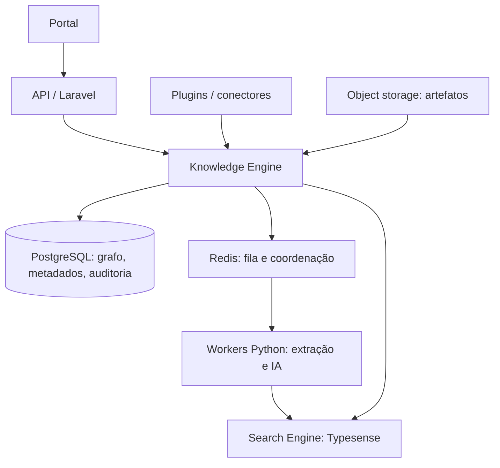

# Knowledge Engineering Platform for Software

Uma plataforma Open Source para transformar código, documentação e evidências operacionais em conhecimento versionado, pesquisável, relacionado, auditável, explicável e consumível por pessoas e agentes de IA.

Não é uma wiki, um gerador de documentação, nem um chat. A plataforma preserva as fontes de verdade e constrói, sobre elas, um **grafo de conhecimento** e índices de busca para responder perguntas com contexto, proveniência e revisão humana.

## Visão

Times de software acumulam conhecimento em repositórios, tickets, ADRs, APIs, diagramas, vídeos e conversas. Esse material envelhece, se contradiz e raramente mantém ligação verificável com o código. Nosso objetivo é oferecer uma camada de engenharia de conhecimento: uma representação navegável das relações entre esses ativos e uma base segura para automação e IA.

Princípios: fontes imutáveis e versionadas; evidência antes de inferência; explicabilidade por padrão; módulos substituíveis; interfaces estáveis; operação simples; extensibilidade por plugins; e humano no controle das publicações.

## Arquitetura



Veja [visão arquitetural](docs/architecture/overview.md), [Knowledge Engine](docs/knowledge-engine/README.md), [busca](docs/search-engine/README.md) e [plugins](docs/plugin-system/README.md).

## Componentes e stack alvo

| Componente | Responsabilidade | Tecnologia inicial |
| --- | --- | --- |
| Portal | experiência humana e administração | React/TypeScript (a decidir em ADR) |
| API | borda, autorização futura e orquestração | Laravel 13 / PHP |
| Knowledge Engine | fontes, versões, grafo, evidências e ciclo de vida | Laravel + PostgreSQL |
| Workers | parsing, embeddings, classificação e tarefas longas | Python |
| Busca | recuperação lexical, vetorial e filtros | Typesense |
| Coordenação | filas, cache efêmero e locks | Redis |
| Artefatos | binários e conteúdo grande | S3-compatível |

Essa é uma arquitetura de referência, não uma implementação presente neste repositório.

## Estrutura

```text
apps/       aplicações implantáveis (vazias por enquanto)
packages/   contratos e SDKs compartilhados
plugins/    extensões isoladas por conector
docs/       fonte de verdade arquitetural e operacional
docker/     futura infraestrutura local
scripts/    automações de desenvolvimento
.github/    automações e templates da comunidade
```

## Roadmap técnico

O produto evolui por capacidades, não por uma lista rígida de tarefas: [roadmap](docs/roadmap/technical-roadmap.md). A primeira fase valida o núcleo de conhecimento e a governança; a segunda traz recuperação híbrida e conectores; a terceira amplia IA assistida, ecossistema e escala.

## Contribuir

Leia [CONTRIBUTING.md](CONTRIBUTING.md), o [Código de Conduta](CODE_OF_CONDUCT.md), a [política de segurança](SECURITY.md) e [AGENTS.md](AGENTS.md). Antes de propor mudanças estruturais, abra ou atualize um ADR.

## Licença

Recomendamos **Apache License 2.0**: permissiva para adoção por empresas, com concessão explícita de patentes. Consulte [LICENSE](LICENSE) e a justificativa no [ADR-008](docs/adr/008-open-source-license.md).

## Documentação

O índice completo está em [docs/README.md](docs/README.md). Documentação é parte do produto: uma alteração sem motivação, impacto e estratégia de evolução não está completa.
