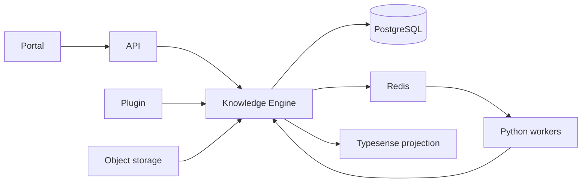
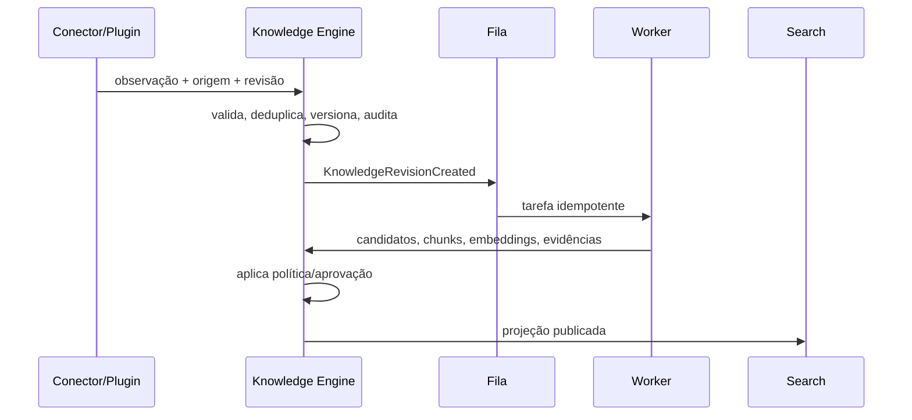
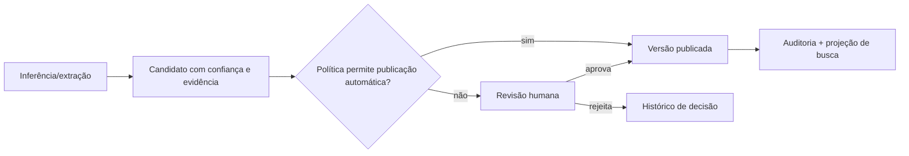

# Arquitetura de referência

## Objetivo e limites

O sistema converte artefatos de engenharia em uma malha de conhecimento consultável. O resultado deve manter ligação com a fonte, revisão e método que o produziu. A plataforma armazena e relaciona conhecimento; não assume posse do código ou substitui sistemas de origem.

O início é um monólito modular no backend, com workers separados apenas onde o runtime e o perfil de carga justificam Python. Isso reduz custo operacional sem fechar a porta para separação futura: fronteiras são contratos/eventos, não processos distribuídos prematuros.

## Módulos e responsabilidades

| Módulo | Faz | Não faz |
| --- | --- | --- |
| Portal | navegação, revisão, visualização e administração | regras centrais ou acesso direto a dados |
| API | borda estável, validação/orquestração e autorização futura | parsing pesado ou lógica duplicada do núcleo |
| Knowledge Engine | identidade, fontes, versões, evidências, relações, ciclo de vida e auditoria | ranking de busca, execução de modelos ou detalhes de conectores |
| Search Engine | projeções recuperáveis, busca híbrida, filtros e ranking | fonte de verdade ou mutação do grafo |
| Workers | extração, chunking, embeddings, classificação e tarefas longas | decidir publicação final sem política do núcleo |
| Plugins | adaptação de sistemas externos e tipos especializados | depender de tabelas internas ou uns dos outros |
| Storage | conteúdo bruto e artefatos grandes | semântica do domínio |

## Comunicação e dependências

Operações síncronas servem apenas para comandos/consultas curtas. Mudanças relevantes emitem eventos de domínio com `event_id`, versão do schema, `occurred_at`, `correlation_id`, ator, escopo e referência à entidade/revisão. Consumidores são idempotentes; entrega é ao-menos-uma-vez. Uma outbox transacional é o desenho alvo para impedir divergência entre grafo e projeções.

Contratos vivem em `packages/contracts`; cada contrato é versionado semanticamente e tolerante a campos desconhecidos. APIs públicas só são adicionadas após estabilização do contrato interno. Plugins e workers usam IDs opacos, nunca chaves internas de banco.

## Fluxo de indexação

## Fluxo de aprovação e IA

IA pode sugerir relações, sínteses ou respostas; deve devolver citações de revisões e configuração de execução. O grafo não aceita uma afirmação sem proveniência ou marcação explícita de hipótese.

## Evolução e trade-offs

PostgreSQL é o sistema de registro para consistência, auditoria e consultas relacionais. Typesense é deliberadamente derivado: sacrifica consultas transacionais em troca de recuperação de baixa latência. O modelo relacional de grafo começa simples; um banco de grafos separado só será considerado após métricas mostrarem que traversals especializados superam a complexidade de duplicação.
