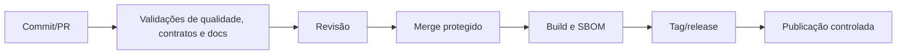

# Processo de desenvolvimento

`main` é a linha integrada e protegida. Branches curtas reduzem divergência; releases recebem tags SemVer (`vMAJOR.MINOR.PATCH`). Mudanças incompatíveis exigem major ou plano de compatibilidade. Releases devem publicar notas com impacto de contratos, segurança, operação e upgrade.

Os workflows versionados em [`.github/workflows/ci.yml`](../../.github/workflows/ci.yml) e [`.github/workflows/docs.yml`](../../.github/workflows/docs.yml) executam em pull requests e em pushes para `main`. A CI roda em paralelo o lint de JavaScript (ESLint e Prettier), PHP (PHP-CS-Fixer), Python (ruff), testes do backend com PostgreSQL e Redis, testes/build do portal, testes dos workers e compilação dos JSON Schemas de `packages/contracts`. A validação documental verifica links relativos e renderiza cada bloco Mermaid.

Backend, workers e JSON Schemas ainda podem não existir nesta fundação. Os respectivos jobs terminam com aviso, sem mascarar falhas: assim que os arquivos de dependência ou schemas forem adicionados, a validação correspondente passa a executar. A contribuição deve usar os templates de issue e de pull request para registrar objetivo, impacto, riscos, métricas e rollback.

