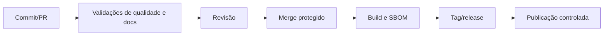

# Processo de desenvolvimento

`main` é a linha integrada e protegida. Branches curtas reduzem divergência; releases recebem tags SemVer (`vMAJOR.MINOR.PATCH`). Mudanças incompatíveis exigem major ou plano de compatibilidade. Releases devem publicar notas com impacto de contratos, segurança, operação e upgrade.

CI proposto valida formatação/lint, testes, tipos, links de Markdown, vulnerabilidades, licenças e artefatos de container. O fluxo é detalhado abaixo; nenhum workflow é implementado ainda.

