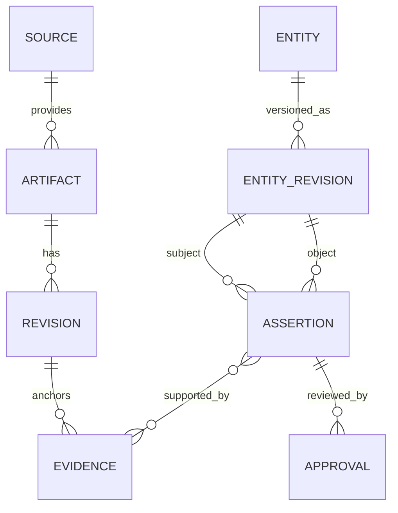

# Knowledge Graph e dados

O grafo é um modelo conceitual sobre PostgreSQL, não uma promessa de banco especializado. Essa decisão dá consistência, transações, backup e operação conhecidos enquanto o domínio amadurece.

## Entidades

| Família      | Exemplos                                                                                |
| ------------ | --------------------------------------------------------------------------------------- |
| Contexto     | Organização, Espaço, Aplicação, Módulo, Processo, Responsável, Integração               |
| Software     | Repositório, Endpoint, Controller, Service, Job, Evento, Tabela, Migration, Tela, Regra |
| Conhecimento | Documento, ADR, FAQ, Comentário, Issue, Release, Vídeo, Print, Diagrama                 |
| Proveniência | Fonte, Artefato, Revisão, Chunk, Evidência, Observação, Execução                        |
| Governança   | Classificação, Política, Aprovação, Auditoria, Retenção                                 |

Uma entidade tem identidade estável e muitas revisões. Uma revisão pode conter múltiplos fragments/chunks. Relações são assertions versionadas, direcionais e qualificadas por escopo, evidência, confiança e autor/método.

Os vetores de chunks ficam em `chunk_embeddings`, vinculados ao checksum do
chunk, modelo, versão, parâmetros e custo. Em PostgreSQL a coluna é pgvector
com índice HNSW; é uma projeção pesquisável, não substitui o texto nem a
proveniência de `chunks`. Consulte a [estratégia de embeddings](../search-engine/embeddings.md).

Relações iniciais: `contains`, `belongs_to`, `implements`, `calls`, `exposes`, `consumes`, `produces`, `reads`, `writes`, `governs`, `documents`, `depends_on`, `supersedes`, `owned_by`, `related_to` e `contradicts`. O vocabulário é extensível, mas novos predicados exigem definição e semântica de inversão quando houver.

## Alimentação e governança

Conectores produzem observações; parsers extraem candidatos; humanos e políticas publicam assertions. Toda transformação retém `source_revision`, extractor/model version, parâmetros relevantes, timestamps e checksum. Eventos preservam ordem por agregado quando relevante, mas consumidores devem tolerar reprocessamento.

Metadados estruturados ficam no banco; blobs originais e binários vão para object storage com hash de conteúdo. Índices de busca recebem somente projeções necessárias. Classificação e escopo são aplicados antes de qualquer recuperação ou entrega a modelo externo.

## Artefatos visuais

Prints e vídeos são observações de uma `Tela`, não anexos. A capacidade `artifact.reader` mantém variante (`desktop` ou `mobile`), tipo, duração de vídeo, dimensões, componentes, relações, miniatura, revisão e evidência OCR nos atributos versionados da Tela. O blob e a miniatura usam chaves SHA-256 imutáveis no object storage; conteúdo idêntico reutiliza o artefato, sem apagar a proveniência da Tela que o referencia. O texto OCR entra como `chunk` da revisão de proveniência e só se torna pesquisável na projeção publicada após governança. O selo de frescor é calculado comparando `artifact_at` com `code_changed_at`, e a saúde “Telas sem print” é uma projeção derivada, não estado persistido. Veja o [Design Document](../development/design-documents/visual-artifact-ingestion.md).

## Outbox e entrega de eventos

A migration `2026_07_31_000300_create_outbox_tables` adiciona `outbox_events` e `processed_events`. A outbox mantém o envelope integral validado contra `domain-event.json`, além de agregado, tipo, correlação, ator, tentativas, disponibilidade e erro. Ela é inserida exclusivamente dentro da transação da mutação de domínio. O dispatcher seleciona apenas o evento pendente mais antigo de cada agregado, publica no Redis e só então o marca como entregue; falhas recebem backoff exponencial e, ao atingir o limite, passam para `dead_letter`. O comando `php artisan outbox:reprocess-dlq` devolve registros da DLQ ao estado pendente.

`processed_events` tem chave primária composta por consumidor e `event_id`. O executor de consumidores cria esse registro e executa o handler na mesma transação, tornando reentregas ao-menos-uma-vez inócuas para consumidores transacionais.

## Persistência da família de proveniência

A migration `2026_07_31_000000_create_provenance_tables` materializa a primeira família de proveniência no backend Laravel. As tabelas `sources`, `artifacts`, `revisions`, `chunks`, `observations` e `executions` preservam, respectivamente, o contexto da fonte, a identidade externa estável, a revisão observada, os trechos derivados, o envelope original de `SourceObservation` e cada execução de extração ou inferência.

As referências de credencial são somente identificadores (`credential_reference`); segredos não são persistidos. Blobs permanecem fora do PostgreSQL e são apontados por `object_storage_pointer`. As relações de chave estrangeira usam `RESTRICT`, e todas as tabelas têm `retention_until` e `deleted_at`: o fluxo normal desativa, supersede ou retrata registros sem remoção física.

Para execuções do Copiloto, `executions.result.reasoning_trace` conserva o traço estruturado da recuperação que fundamentou a resposta candidata. O JSON inclui sua versão, escopo interpretado, contagens, decisões e evidências de confronto/regra com revisões e URIs; é parte do mesmo resultado idempotente da execução, e não uma nova fonte de verdade no grafo.

Na recepção, a chave de idempotência identifica a resposta repetível e a combinação de fonte, artefato externo, revisão e checksum identifica a observação semântica. A mesma revisão com checksum diferente é rejeitada como conflito. O conteúdo que excede `INGESTION_INLINE_CONTENT_LIMIT_BYTES` é gravado no disco configurado por hash de conteúdo, em caminho imutável.

Os índices cobrem `source_id`, `content_hash` e `observed_at`; PostgreSQL também recebe GIN para os documentos JSONB de metadados e registros de execução/observação. A migration é testável em SQLite, onde esses índices específicos de PostgreSQL não são emitidos.

## Persistência do grafo

A migration `2026_07_31_000100_create_knowledge_graph_tables` materializa o grafo relacional previsto pelo ADR-003. `entities` preserva a identidade estável, seu tipo do vocabulário, família, escopo, chave natural externa e proprietário; `entity_revisions` contém versões imutáveis ancoradas em uma `revision` de proveniência. A unicidade de `(entity_id, version)` impede versões concorrentes com o mesmo número, e uma revisão `superseded` referencia explicitamente sua sucessora.

`assertions` aponta sempre para uma revisão-sujeito e contém um único objeto: outra revisão de entidade ou valor literal. Suas relações seguem o vocabulário inicial deste documento, com escopo, confiança, método, ator, estado e intervalo de validade. `assertion_evidence` ancora cada assertion em exatamente um `chunk`, `artifact` ou evento de observação, com peso. No PostgreSQL, triggers de constraint deferrable exigem ao menos uma evidência antes do commit para métodos diferentes de `human_declared`, tanto na criação quanto na remoção da última evidência. Isso permite persistir assertion e evidência na mesma transação sem abrir exceção para dados não auditáveis.

As views `published_entity_revisions` e `published_assertions` são modelos de leitura autoritativos apenas para os registros publicados. Índices nas duas direções de uma assertion, por predicado, escopo, tipo e família atendem traversals de vizinhança e filtros sem tratar a busca como fonte de verdade.

`assertion_relations` registra relações entre assertions, inicialmente somente a relação simétrica `contradicts`. Ela é criada pelo serviço de ciclo de vida ao publicar assertions com mesmo sujeito e predicado, mas objetos incompatíveis; o registro não escolhe vencedora nem elimina o conhecimento concorrente.

## Leitura diagnóstica pelo Portal

O modelo de leitura HTTP do Graph limita a travessia a uma entidade foco e profundidade 1 por padrão (máximo 3 mediante ação explícita). Ele lê entidades e assertions publicadas, devolve pesos e tokens de cor, mas nunca coordenadas: o layout pertence ao Portal. O diagnóstico combina atributos publicados (responsável e print de tela) com eventos `dead_letter` da outbox para apontar lacunas, sempre após autorização de escopo e classificação. O contrato completo está em [API de leitura do Knowledge Graph](../development/design-documents/knowledge-graph-read-api.md).

O `AssertionGraphService` resolve referências de entidades para revisões concretas antes da persistência, valida o `GraphPredicate` pelo enum canônico e exige evidência para métodos não humanos. Sua confiança combina peso e frescor das evidências (`1 - ∏(1 - peso × frescor)`, meia-vida de 30 dias). A vizinhança é uma consulta autoritativa em `published_assertions`, agrupada pela semântica do predicado na direção consultada; cada relação inclui evidências, método, escopo e confiança. Ao superseder uma revisão, assertions publicadas dependentes são mantidas no histórico como `superseded`; cópias candidatas apontam à sucessora e passam novamente pela governança.

## Persistência da família de governança

A migration `2026_07_31_000200_create_governance_tables` materializa classificações, políticas, responsáveis, aprovações, retenção e auditoria. `classifications` define o nível e as permissões explícitas de busca, exibição e envio a provedor externo antes de qualquer projeção ou chamada de modelo.

`policies.rules` contém a regra normalizada do documento YAML versionado `governance-policy` v1. `policy_key`, `version`, `schema_version` e checksum tornam cada regra reproduzível; uma versão carregada não é atualizada. `applies_to` limita fonte, entidade, classificação, método, confiança, escopo, dono e impacto. A resolução escolhe de forma determinística a política ativa, vigente e aplicável por prioridade, especificidade, chave e versão, registrando a explicação. O resultado inclui ação (`publish`, `review` ou `block`), aprovadores, validade e selo de frescor derivado. `owners` registra uma ou mais responsabilidades `technical` e `business` por escopo/módulo, sem assumir que uma única pessoa aprova toda mudança.

`approvals` preserva a proposta, o sujeito revisado, a política aplicada, proponente, revisor humano, decisão, justificativa, horários e referência externa de PR. No PostgreSQL, checks garantem que a decisão tenha revisor, timestamp e justificativa, e que o sujeito seja exatamente uma revisão de entidade ou assertion.

`audit_log` registra ator, ação, sujeito, entidade/revisão, decisão, motivo, correlação, snapshots anterior/posterior, classificação e método/confiança. `subject_id` preserva o identificador do alvo mesmo quando ele não é uma revisão. A escrita ocorre somente pela porta `AuditTrail`, que redige segredos e omite conteúdo excessivo antes da persistência. É append-only: triggers bloqueiam `UPDATE` e `DELETE` tanto em PostgreSQL como no banco SQLite usado nos testes. O índice `(entity_id, occurred_at)` atende o Histórico do Portal em ordem decrescente. `retention_rules` declara precedência, escopo, prazo, disposição e possibilidade de retenção legal; não autoriza apagar a auditoria.
