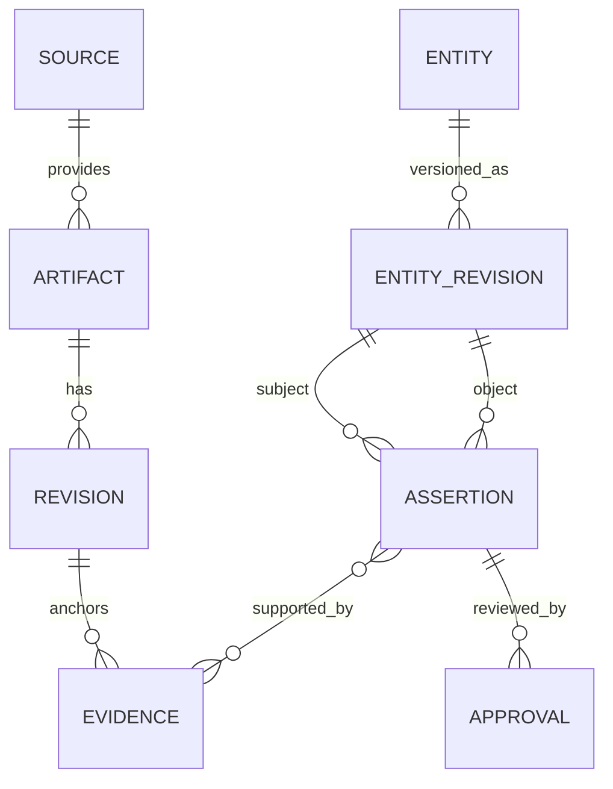

# Knowledge Graph e dados

O grafo é um modelo conceitual sobre PostgreSQL, não uma promessa de banco especializado. Essa decisão dá consistência, transações, backup e operação conhecidos enquanto o domínio amadurece.

## Entidades

| Família | Exemplos |
| --- | --- |
| Contexto | Organização, Espaço, Aplicação, Módulo, Processo, Responsável, Integração |
| Software | Repositório, Endpoint, Controller, Service, Job, Evento, Tabela, Migration, Tela, Regra |
| Conhecimento | Documento, ADR, FAQ, Comentário, Issue, Release, Vídeo, Print, Diagrama |
| Proveniência | Fonte, Artefato, Revisão, Chunk, Evidência, Observação, Execução |
| Governança | Classificação, Política, Aprovação, Auditoria, Retenção |

Uma entidade tem identidade estável e muitas revisões. Uma revisão pode conter múltiplos fragments/chunks. Relações são assertions versionadas, direcionais e qualificadas por escopo, evidência, confiança e autor/método.

Relações iniciais: `contains`, `belongs_to`, `implements`, `calls`, `exposes`, `consumes`, `produces`, `reads`, `writes`, `governs`, `documents`, `depends_on`, `supersedes`, `owned_by`, `related_to` e `contradicts`. O vocabulário é extensível, mas novos predicados exigem definição e semântica de inversão quando houver.

## Alimentação e governança

Conectores produzem observações; parsers extraem candidatos; humanos e políticas publicam assertions. Toda transformação retém `source_revision`, extractor/model version, parâmetros relevantes, timestamps e checksum. Eventos preservam ordem por agregado quando relevante, mas consumidores devem tolerar reprocessamento.

Metadados estruturados ficam no banco; blobs originais e binários vão para object storage com hash de conteúdo. Índices de busca recebem somente projeções necessárias. Classificação e escopo são aplicados antes de qualquer recuperação ou entrega a modelo externo.
