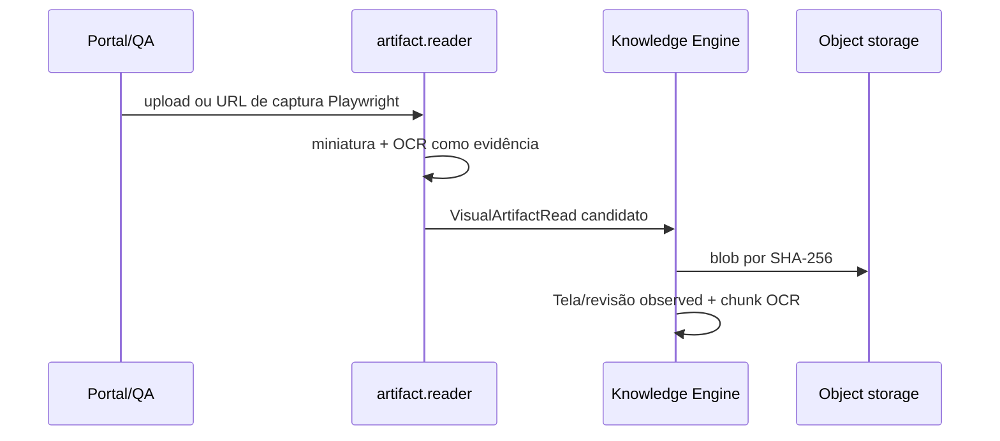

# Ingestão de artefatos visuais

## Objetivo

Esta capacidade implementa `artifact.reader` para receber prints e vídeos como observações versionadas de uma entidade `Tela`. A solicitação da tarefa 34 autoriza o endpoint de upload manual e o retorno do worker; uma revisão humana de arquitetura continua necessária antes de publicação em produção.

## Fluxo e limites

O worker executa Playwright em runtime isolado e só aceita URL HTTP(S); a allowlist de egress é responsabilidade da implantação. O resultado traz hash, método, revisão, horário e confiança OCR. A imagem/vídeo e a miniatura ficam no object storage, com chave de hash imutável. A mesma hash reutiliza o artefato e o blob; cada Tela recebe uma revisão que aponta para essa proveniência.

OCR é evidência pesquisável, não uma declaração autoritativa: a revisão fica em `observed` e segue a política de governança antes de qualquer projeção publicada. Componentes, relacionamentos, duração, variantes e histórico são atributos versionados da Tela; comentários e relações continuam usando as entidades/assertions existentes.

## Frescor, riscos e rollback

O selo compara `artifact_at` à última `code_changed_at`; por exemplo, uma referência de cinco meses resulta em `print desatualizado há 5 meses`. A métrica de dashboard é derivada: telas sem uma revisão visual de tipo `print`, nunca um contador persistido.

Riscos: OCR incorreto, captura de conteúdo restrito e crescimento de blobs. Limites do manifesto, autorização antes da escrita, classificação interna e deduplicação por hash reduzem o impacto. Rollback: desabilitar o plugin/rota e retratar ou superseder revisões observadas, preservando auditoria e blobs segundo retenção.
