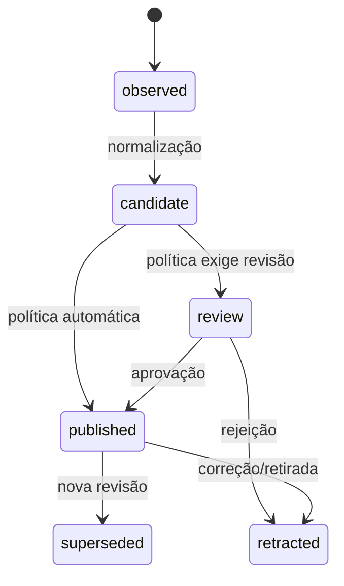

# Knowledge Engine

O Knowledge Engine é o núcleo semântico. Sua responsabilidade é transformar entradas de fontes em conhecimento versionado e rastreável, sem assumir como foram extraídas ou como serão pesquisadas.

## Responsabilidades

- registrar fonte, escopo, licença/origem, credencial de acesso por referência e revisão observada;
- normalizar identidade, preservar conteúdo/referência e criar versões imutáveis;
- manter entidades, relações, evidências, confiança e decisões de curadoria;
- decidir estados (`observed`, `draft`, `candidate`, `review`, `published`, `superseded`, `retracted`) segundo políticas;
- registrar uma trilha de auditoria e emitir eventos para projeções.

## Contratos conceituais

`SourceObservation` contém identificador externo estável, tipo, URI, revisão, timestamp, conteúdo ou referência e metadados. `KnowledgeEntity` é uma identidade estável (por exemplo, endpoint). `KnowledgeRevision` descreve seu estado naquele ponto de origem. `Assertion` associa sujeito, predicado e objeto/valor. `Evidence` aponta para trecho, artefato ou evento que sustenta a assertion.

Todos os comandos incluem idempotency key e contexto de ator. Todos os eventos incluem schema version. A eliminação física é exceção de retenção/privacidade; a regra padrão é superseder ou retratar, preservando auditabilidade.

## Serviço de ciclo de vida

O `KnowledgeLifecycleService` é a única porta de aplicação para transições de revisões e assertions. Ele consulta a política declarativa aplicável, exige evidência para assertions não declaradas por humano, exige ator e motivo, grava `audit_log` imutável e inclui o evento de domínio na outbox dentro da mesma `UnitOfWork`. Ao publicar uma revisão, qualquer revisão publicada anterior da mesma entidade é marcada como `superseded` e aponta para a sucessora. Ao retratar uma revisão, assertions publicadas que a usam como sujeito ou objeto também são retratadas, sem remoção física.

Assertions concorrentes publicadas para o mesmo sujeito e predicado permanecem coexistentes. Quando seus objetos (ou valores literais) diferem, a tabela `assertion_relations` registra a aresta simétrica `contradicts` entre as duas assertions; ela não substitui nem oculta as evidências concorrentes.

## Ciclo de vida

Conflitos não são apagados automaticamente: coexistem como assertions concorrentes com evidências e escopo. A curadoria resolve ou marca a incerteza. Isso evita que automação destrua contexto histórico.

## Interface com outros módulos

Plugins enviam observações; workers devolvem resultados candidatos; Search Engine recebe somente projeções publicadas; Portal/API consultam modelos de leitura do núcleo. Nenhum deles altera diretamente relações persistidas.

O fluxo de aprovação humana em Governança chama o `KnowledgeLifecycleService` para publicar ou retratar a revisão após registrar a decisão. A abertura de Pull Request é feita por um conector externo antes dessa transição; falha de conector não pode publicar conteúdo. Relações `depends_on` publicadas produzem propostas pendentes de revisão automática para as revisões dependentes, sem alterar diretamente sua versão publicada.

`AuditTrail` é a porta transversal de auditoria. A implementação do Knowledge Engine aceita atores `human`, `ci`, `plugin`, `model`, `service` e `worker`, exige ação, sujeito e motivo, e fornece histórico ordenado por entidade. O tipo `model` identifica a execução, mas não altera a regra de que seus resultados são candidatos até aprovação humana.

## Recepção de observações

O módulo Ingestion valida `SourceObservation` contra o contrato, exige ator e idempotency key, e deduplica a combinação de fonte, identificador externo, revisão e checksum. A mesma revisão com checksum divergente é um conflito, nunca sobrescrita. Conteúdo acima do limite configurado é endereçado pelo hash no object storage; a transação preserva artefato, revisão, observação, execução do extractor e a `entity_revision` em `observed`, junto do evento `KnowledgeRevisionCreated` na outbox.

Fontes com classificação semântica podem declarar `metadata.entity_type` usando o
vocabulário canônico do grafo. A entrada continua sendo uma `SourceObservation`
completa — fonte, revisão, checksum, método e auditoria continuam obrigatórios
— e a família é calculada pelo núcleo. Atributos semânticos entram em
`metadata.attributes`, sem poder substituir os atributos de proveniência.

## Persistência do domínio

O backend implementa agregados puros para `Source`, `KnowledgeEntity`, `KnowledgeRevision`, `Assertion` e `Evidence`, além dos value objects de identidade estável, escopo, confiança, método de derivação e ciclo de vida. As interfaces de repositório pertencem ao domínio; seus adaptadores Eloquent e os modelos persistentes ficam exclusivamente em `Infrastructure/Persistence`.

Toda escrita é executada pelo `UnitOfWork`: ele abre a transação, permite que os repositórios gravem o agregado e insere o envelope validado do evento correspondente na outbox antes do commit. Os repositórios recusam gravações fora dessa transação; portanto, camadas de aplicação, HTTP, plugins e workers não instanciam modelos Eloquent do grafo.

## Assertions, evidências e vizinhança

`AssertionGraphService` é a porta de aplicação para criar assertions candidatas e consultar a vizinhança de uma entidade. Ele aceita exclusivamente `GraphPredicate` do contrato v1, resolve sujeito e objeto para uma revisão concreta e ativa da entidade e persiste as evidências na mesma `UnitOfWork`. Métodos não humanos — incluindo `parser`, `analyzer` e `inference` — exigem ao menos uma evidência; `human_declared` é a exceção explícita.

A confiança de uma assertion com evidências é `1 - ∏(1 - peso × frescor)`. O frescor decai exponencialmente, com meia-vida de 30 dias, a partir do registro da evidência. Sem evidência humana, permanece a confiança declarada pelo humano. A consulta de vizinhança lê apenas `published_assertions`, agrupa por predicado visível da perspectiva da entidade e devolve contraparte, evidências, método, escopo e confiança. Predicados assimétricos aplicam sua inversão ao consultar o objeto (por exemplo, `contains` aparece como `belongs_to`).

Quando uma revisão publicada é supersedida, assertions publicadas que a referenciam são supersedidas e o serviço cria cópias candidatas ancoradas na revisão sucessora, com evidências preservadas e confiança recalculada. A cópia nunca é publicada automaticamente por esse processo: ela volta ao fluxo de governança para aprovação humana ou política aplicável.
