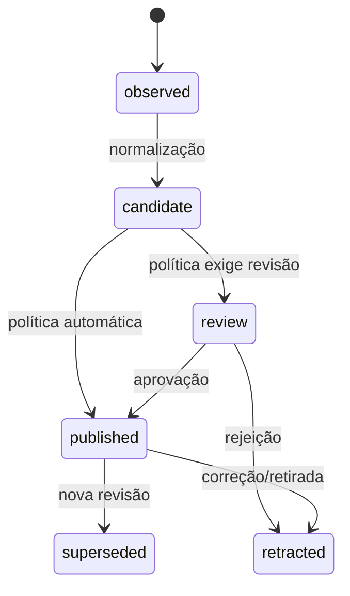

# Knowledge Engine

O Knowledge Engine é o núcleo semântico. Sua responsabilidade é transformar entradas de fontes em conhecimento versionado e rastreável, sem assumir como foram extraídas ou como serão pesquisadas.

## Responsabilidades

- registrar fonte, escopo, licença/origem, credencial de acesso por referência e revisão observada;
- normalizar identidade, preservar conteúdo/referência e criar versões imutáveis;
- manter entidades, relações, evidências, confiança e decisões de curadoria;
- decidir estados (`draft`, `candidate`, `review`, `published`, `superseded`, `retracted`) segundo políticas;
- registrar uma trilha de auditoria e emitir eventos para projeções.

## Contratos conceituais

`SourceObservation` contém identificador externo estável, tipo, URI, revisão, timestamp, conteúdo ou referência e metadados. `KnowledgeEntity` é uma identidade estável (por exemplo, endpoint). `KnowledgeRevision` descreve seu estado naquele ponto de origem. `Assertion` associa sujeito, predicado e objeto/valor. `Evidence` aponta para trecho, artefato ou evento que sustenta a assertion.

Todos os comandos incluem idempotency key e contexto de ator. Todos os eventos incluem schema version. A eliminação física é exceção de retenção/privacidade; a regra padrão é superseder ou retratar, preservando auditabilidade.

## Ciclo de vida

Conflitos não são apagados automaticamente: coexistem como assertions concorrentes com evidências e escopo. A curadoria resolve ou marca a incerteza. Isso evita que automação destrua contexto histórico.

## Interface com outros módulos

Plugins enviam observações; workers devolvem resultados candidatos; Search Engine recebe somente projeções publicadas; Portal/API consultam modelos de leitura do núcleo. Nenhum deles altera diretamente relações persistidas.
