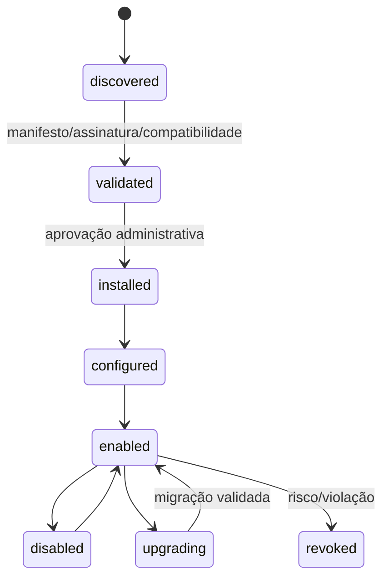
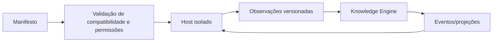

# Plugin System

Plugins ampliam a plataforma sem transformar o núcleo em uma coleção de integrações específicas. Um plugin é um adaptador versionado que declara o que sabe observar, produzir ou apresentar; não recebe privilégio implícito.

## Modelo e contrato

Cada plugin ocupa um diretório próprio em `plugins/<publisher>/<nome>/`, com manifesto declarativo, documentação, testes e changelog. O manifesto declara `id` imutável, versão SemVer, compatibilidade da plataforma, runtime, capacidades, configurações, permissões, schemas de entrada/saída, limites e política de retry.

As capacidades do contrato incluem `source.connector`, `content.parser`, `code.analyzer`, `artifact.reader` e `enrichment.provider`. Os plugins oficiais presentes cobrem GitHub, Markdown, OpenAPI, artefatos visuais, Laravel e React; GitLab, Azure DevOps e os demais analisadores continuam extensões futuras do mesmo contrato.

## Contrato e ciclo de vida

O host chama contratos estáveis: descoberta incremental, obtenção de artefato, parsing para observações, health check e encerramento. Calls recebem contexto limitado, correlação, deadline e idempotency key. Resultados retornam observações e evidências; não realizam escrita direta no grafo.

## Implementação inicial no backend

O módulo `Plugins` mantém `plugin_registrations` e o histórico imutável de transições em `plugin_lifecycle_events`. O manifesto é validado pelo contrato [`plugin-manifest.json`](../../packages/contracts/schemas/v1/plugin-manifest.json); instalação e upgrade revalidam a faixa de compatibilidade da plataforma e as permissões permitidas pelo host. A porta `PluginHost` só encaminha chamadas a plugins habilitados e transporta `PluginExecutionContext` limitado a escopo, `correlation_id`, deadline e `idempotency_key`. O resolvedor de runtime padrão falha fechado até que o executor de containers/worker isolado seja provisionado.

## Isolamento e segurança

O host implementa a fronteira de execução isolada, com política derivada do manifesto, limite de payload, referências `secret://` e circuit breaker. O adaptador de control plane só executa por um executor isolado configurado e falha fechado na sua ausência; ele não possui fallback no processo Laravel. A implantação do runtime de containers, a allowlist efetiva de egress e a verificação de proveniência de artefatos permanecem requisitos operacionais para habilitar plugins em produção ou marketplace aberto, conforme o [ADR-013](../adr/013-plugin-runtime-isolation.md).

Plugins não podem acessar PostgreSQL, Redis, índices ou segredos de outros plugins. Eventos públicos substituem chamadas internas. Falhas são isoladas por plugin, observáveis e não impedem o núcleo de operar.

O modelo executável, as ameaças cobertas e o caminho para verificação de proveniência estão em [Segurança de plugins](security.md). O host deriva uma política imutável do manifesto aprovado, exige `cpu_millicores`, `memory_mebibytes`, timeout e payload máximo, e só permite egress quando uma `egress_allowlist` explícita acompanha `network.egress`. O adaptador de runtime não tem fallback no processo Laravel: enquanto o control plane de containers não estiver configurado, falha fechado.

## Fluxo

O trade-off é mais disciplina e alguma latência. Em troca, conectores evoluem sem acoplar releases do núcleo e um plugin defeituoso tem raio de explosão controlado.

## Analisadores de código iniciais

Os plugins [`atlas.laravel`](../../plugins/atlas/laravel/README.md) e [`atlas.react`](../../plugins/atlas/react/README.md) declaram `code.analyzer` e compartilham o runtime Python isolado. Eles recebem apenas snapshots Base64 já observados, produzem `code-analysis-result.json` e preservam arquivo, linha, commit, revisão, método e confiança em cada candidato ou assertion. Ambos declaram versões de framework suportadas, limites de repositório e tempo máximo de análise; seus resultados são sempre candidatos reprocessáveis, nunca publicação automática.

O [`guia para analisadores de código`](writing-a-code-analyzer.md) orienta contribuições para Angular, Vue, Node, Python, Java e .NET a partir dessas duas referências.

## Conector GitHub inicial

O plugin [`atlas.github`](../../plugins/atlas/github/README.md) é o primeiro `source.connector`. Ele descobre incrementalmente repositórios e paths autorizados, lê cada arquivo por commit SHA, preserva histórico de commits e produz `SourceObservation` v1. Também valida webhooks assinados antes de gerar nova descoberta e implementa a abertura de Pull Request requerida pela aprovação humana. GitLab e Azure DevOps devem implementar a mesma superfície Git documentada no plugin, sem expor detalhes do provedor ao Knowledge Engine ou à Governança.

## Plugins oficiais

| Plugin                                                       | Capacidade         | Operação do worker                           | Contrato de saída           |
| ------------------------------------------------------------ | ------------------ | -------------------------------------------- | --------------------------- |
| [`atlas.markdown`](../../plugins/atlas/markdown/README.md)   | `content.parser`   | `content.parse` (Markdown e PDF)             | `content-parse-result` v1   |
| [`atlas.openapi`](../../plugins/atlas/openapi/README.md)     | `content.parser`   | `openapi.parse` (OpenAPI 3.x)                | `content-parse-result` v1   |
| [`atlas.artifacts`](../../plugins/atlas/artifacts/README.md) | `artifact.reader`  | `artifact.read` (prints, vídeo e Playwright) | `visual-artifact-result` v1 |
| [`atlas.laravel`](../../plugins/atlas/laravel/README.md)     | `code.analyzer`    | `code.analyze`                               | `code-analysis-result` v1   |
| [`atlas.react`](../../plugins/atlas/react/README.md)         | `code.analyzer`    | `code.analyze`                               | `code-analysis-result` v1   |
| [`atlas.github`](../../plugins/atlas/github/README.md)       | `source.connector` | descoberta e artefato Git                    | `source-observation` v1     |

Os três parsers são pacotes independentes sobre o `PluginHost`: declaram apenas contratos públicos, operação, limites, retry, idempotência e métricas. Todos produzem candidatos/observações com proveniência e evidência; não dependem de tabelas, outros plugins ou detalhes do núcleo. Podem permanecer desabilitados sem alterar a suíte do núcleo.

## Publicação de um plugin oficial

1. Versione o pacote e o manifesto juntos, mantendo `id` imutável e a compatibilidade SemVer da plataforma.
2. Valide o manifesto contra [`plugin-manifest.json`](../../packages/contracts/schemas/v1/plugin-manifest.json), execute os testes e lint do pacote e valide os contratos de saída usados.
3. Publique a imagem/runtime isolado com proveniência verificável; o manifesto só referencia segredos por `secret://` e declara egress, limites e métricas.
4. Registre o manifesto no host, valide compatibilidade e permissões, e obtenha aprovação administrativa antes de habilitá-lo.
5. Monitore métricas por `plugin_id` e `correlation_id`. Para rollback, desabilite o registro: observações e execuções já auditadas são preservadas, enquanto o núcleo continua operando.
