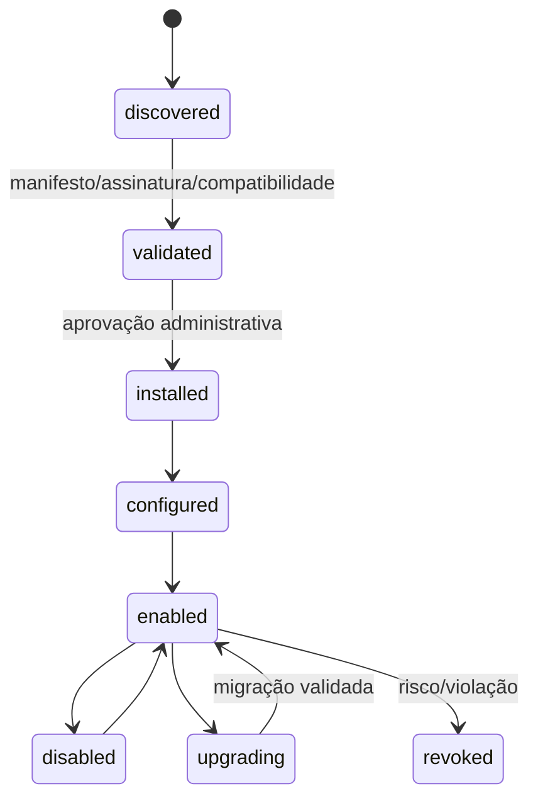
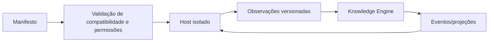

# Plugin System

Plugins ampliam a plataforma sem transformar o núcleo em uma coleção de integrações específicas. Um plugin é um adaptador versionado que declara o que sabe observar, produzir ou apresentar; não recebe privilégio implícito.

## Modelo proposto

Cada plugin terá diretório próprio em `plugins/<publisher>/<nome>/`, manifesto declarativo, documentação, testes e changelog. O manifesto declara `id` imutável, versão SemVer, compatibilidade da plataforma, runtime, capacidades, configurações, permissões, schemas de entrada/saída, limites e política de retry.

Capacidades iniciais previstas: `source.connector` (GitHub, GitLab, Azure DevOps), `content.parser` (Markdown, PDF, OpenAPI, Storybook, Draw.io, Mermaid), `code.analyzer` (Laravel, React, Angular, Vue, Node, Python), `artifact.reader` (Playwright, vídeo/print) e `enrichment.provider`.

## Contrato e ciclo de vida

O host chama contratos estáveis: descoberta incremental, obtenção de artefato, parsing para observações, health check e encerramento. Calls recebem contexto limitado, correlação, deadline e idempotency key. Resultados retornam observações e evidências; não realizam escrita direta no grafo.

## Isolamento e segurança

O primeiro modelo deve priorizar execução fora do processo do backend, em container/runtime controlado, com egress allowlist, filesystem efêmero, secrets de curta duração e permissões mínimas. Webhooks e conectores externos passam por validação e rate limit. Assinatura/verificação de proveniência é uma evolução necessária antes de marketplace aberto.

Plugins não podem acessar PostgreSQL, Redis, índices ou segredos de outros plugins. Eventos públicos substituem chamadas internas. Falhas são isoladas por plugin, observáveis e não impedem o núcleo de operar.

## Fluxo

O trade-off é mais disciplina e alguma latência. Em troca, conectores evoluem sem acoplar releases do núcleo e um plugin defeituoso tem raio de explosão controlado.
