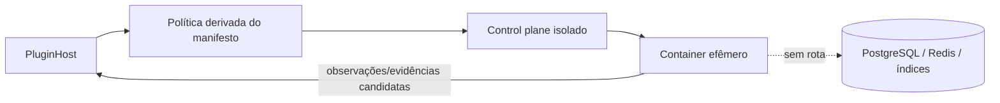

# Segurança de plugins

## Objetivo

O host executa plugins fora do processo do backend, em container ou runtime controlado. Esta fronteira reduz o raio de explosão de conectores e analisadores que processam conteúdo e endpoints potencialmente hostis. O contrato de execução contém apenas ID do plugin, operação, escopo limitado, correlação, deadline, idempotência e payload validado; ele nunca recebe handles ou URLs de PostgreSQL, Redis ou Typesense.

## Controles implementados

- Cada execução deriva limites de CPU, memória, concorrência, deadline e tamanho máximo de payload do manifesto validado.
- O filesystem do sandbox é efêmero. Não há volume do backend, socket de Docker, cache compartilhado ou credencial de banco montado no container.
- A rede começa negada. `network.egress` só habilita destinos em `egress_allowlist`; endpoints internos, stores e metadata services não fazem parte dessa lista.
- Configurações que parecem segredo aceitam somente referências `secret://`. O manifesto e os logs não persistem valores. O executor recebe a referência para obter uma credencial de curta duração no runtime; a credencial materializada não retorna ao host nem entra em logs.
- Permissões são verificadas na instalação e a política efetiva é o subconjunto mínimo declarado pelo manifesto. Plugins devolvem somente observações/evidências candidatas através de contratos.
- Erros têm `plugin_id` e `correlation_id` no log, sem payload ou segredo. Um circuit breaker contado por plugin abre no limiar configurado, desabilita apenas aquele registro e emite a métrica `plugin_circuit_opened_total`.
- Webhooks são admitidos somente após HMAC com comparação em tempo constante e rate limit por plugin+origem. Repetição e idempotência continuam sendo resolvidas no contrato de ingestão.

## Modelo de ameaça

| Ameaça | Mitigação |
| --- | --- |
| Plugin comprometido tenta ler stores internos | Sem credenciais, rotas ou mounts; runtime isolado e allowlist de egress. |
| Exfiltração por rede | Egress negado por padrão e allowlist por plugin. |
| Vazamento de segredo em manifesto/log | Apenas referências `secret://`; injeção temporária no runtime e logs sanitizados. |
| Payload malicioso ou consumo excessivo | Limites de bytes, tempo, CPU e memória antes e durante a execução. |
| Plugin instável degrada o núcleo | Falha contida, logs/métricas correlacionados e circuit breaker por plugin. |
| Webhook forjado ou abusivo | Assinatura HMAC e rate limit antes de chamar o conector. |

## Proveniência e marketplace

Antes de um marketplace aberto, a transição `discovered → validated` deverá exigir uma declaração de proveniência assinada que vincule `plugin_id`, versão, digest do artefato, publisher e compatibilidade. O control plane verificará a assinatura contra uma cadeia de confiança de publishers aprovada, registrará digest e resultado da verificação no evento imutável de ciclo de vida e recusará artefatos cujo digest não corresponda ao manifesto. Até essa verificação estar implementada, instalações são administrativas e o executor falha fechado quando não há runtime controlado.

## Operação e rollback

O limiar e a janela do circuit breaker são configuráveis. Para rollback, desabilite o plugin: o núcleo continua recebendo e servindo conhecimento já registrado, porque nenhuma execução de plugin é parte da transação do Knowledge Engine. Reabilitação requer intervenção administrativa e nova observação das métricas de falha.
