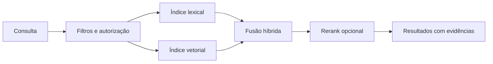

# Search Engine

Busca é uma projeção descartável e reconstruível do conhecimento publicado. Ela otimiza descoberta; o Knowledge Engine continua sendo autoritativo para conteúdo, versões e permissões.

## Estratégia híbrida

1. **Lexical** recupera termos exatos, identificadores, paths e siglas — indispensável para engenharia de software.
2. **Semântica** recupera proximidade de significado por embeddings, útil quando o vocabulário diverge.
3. **Filtros** limitam escopo, aplicação, tipo, versão, fonte, tempo, classificação e estado antes do ranking.
4. **Fusão** combina resultados normalizados (RRF como ponto inicial), preservando origem das pontuações.
5. **Rerank** opcional reordena apenas um conjunto pequeno; aumenta qualidade, mas tem custo/latência e não deve ser requisito para resposta.

Typesense é a projeção de busca implementada para texto, filtros, facetas e vetores; não é usado como banco de dados. A implementação inclui reindexação completa, versão de schema, registro de falhas para reprocessamento e métricas de lag. A configuração de modelo, chunking e migração é vinculante no [ADR-012](../adr/012-embedding-model.md).

## Projeção publicada no Typesense

O módulo `Search` implementa a coleção versionada `knowledge_published_v<N>`. Ela contém texto em `title`, `body`, `path`, `aliases` e `identifiers`; facetas de `application`, `module`, `entity_type`, `source`, `owner`, `state`, `classification` e `freshness`; ordenação por `relevance`, `updated_at` e `access_count`; e o vetor opcional `embedding`. A definição é centralizada em `PublishedKnowledgeSchema`; mudar o contrato do índice exige nova versão de schema e reindexação.

`PublishedKnowledgeProjector` é consumidor idempotente de `KnowledgeRevisionLifecycleChanged`. Para publicar, ele lê a view autoritativa `published_entity_revisions` com a proveniência necessária e grava uma projeção no alias `knowledge_published`; para qualquer outro estado, remove o documento. Assim, rascunhos, candidatos e retratações nunca chegam ao índice. Ao publicar uma nova revisão, a projeção anterior da mesma entidade é removida antes do upsert.

`php artisan search:reindex-published` cria uma coleção física nova, carrega somente a view publicada e troca o alias Typesense depois de concluir a carga. A troca de alias é atômica; a coleção anterior permanece disponível como rollback operacional. Falhas do projetor são registradas em `search_projection_failures` com envelope e erro para reprocessamento controlado. `search_projection_metrics` registra o lag, em milissegundos, entre `published_at` e a disponibilidade no índice.

## Integração com IA

RAG recebe documentos/chunks publicados, filtros de escopo e referências de evidência. A resposta deve citar revision IDs/URIs e informar quando a recuperação é insuficiente. RAG não altera o conhecimento; feedback do usuário entra como observação separada.

## Qualidade

Avaliar recall, MRR/nDCG, latência p50/p95, taxa de zero-result, cobertura de citações, custo de rerank e lag. Um conjunto de queries de avaliação, versionado e sem dados sensíveis, é pré-requisito para trocar embeddings, fusão ou ranking.

A suíte, o comando de medição, a série temporal e a regra de regressão estão
documentados em [Qualidade de busca](quality.md).

A estratégia operacional de chunking, persistência vetorial, custo e migração
de modelo está em [Embeddings e índice vetorial](embeddings.md).

Consultas sem resultado também são registradas como ocorrências de lacuna,
preservando pergunta, escopo, correlação, método e confiança fora do índice.
Isso substitui o log operacional como fonte do card de perguntas sem resposta;
detalhes estão na [API de lacunas](../development/design-documents/knowledge-gaps-api.md).
