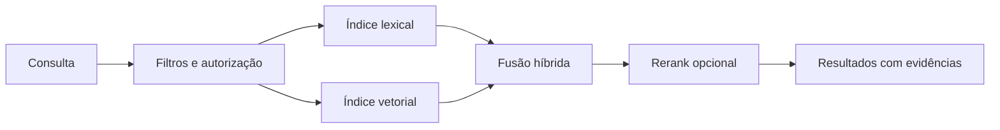

# Search Engine

Busca é uma projeção descartável e reconstruível do conhecimento publicado. Ela otimiza descoberta; o Knowledge Engine continua sendo autoritativo para conteúdo, versões e permissões.

## Estratégia híbrida

1. **Lexical** recupera termos exatos, identificadores, paths e siglas — indispensável para engenharia de software.
2. **Semântica** recupera proximidade de significado por embeddings, útil quando o vocabulário diverge.
3. **Filtros** limitam escopo, aplicação, tipo, versão, fonte, tempo, classificação e estado antes do ranking.
4. **Fusão** combina resultados normalizados (RRF como ponto inicial), preservando origem das pontuações.
5. **Rerank** opcional reordena apenas um conjunto pequeno; aumenta qualidade, mas tem custo/latência e não deve ser requisito para resposta.

Typesense é o alvo inicial por oferecer texto, filtros, facetas e vetores com operação simples. Não é usado como banco de dados. Devem existir reindexação completa, versionamento de schema do índice, DLQ/retry e métricas de lag de projeção.

## Integração com IA

RAG recebe documentos/chunks publicados, filtros de escopo e referências de evidência. A resposta deve citar revision IDs/URIs e informar quando a recuperação é insuficiente. RAG não altera o conhecimento; feedback do usuário entra como observação separada.

## Qualidade

Avaliar recall, MRR/nDCG, latência p50/p95, taxa de zero-result, cobertura de citações, custo de rerank e lag. Um conjunto de queries de avaliação, versionado e sem dados sensíveis, é pré-requisito para trocar embeddings, fusão ou ranking.
